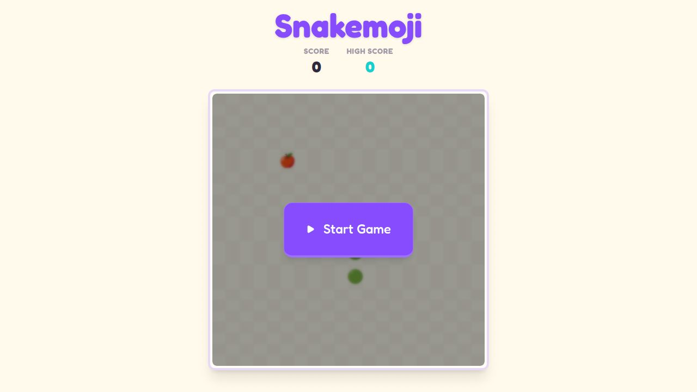

# Snakemoji 🐍🍎
A playful, emoji version of the classic Snake game built with React, Tailwind CSS, and Framer Motion. 

[](https://snakemoji.vercel.app)

## Features
- **Expressive Emoji Snake:** The snake head changes expression (`😳` → `😮`) when it gets close to food!
- **Dynamic Fruit Food:** Random fruit emojis appear on the board for the snake to eat.
- **Confetti Milestones:** A burst of confetti appears every time you score 5 points. 🎉
- **Cross-Platform Controls:** Use keyboard arrows on desktop or the interactive on-screen D-Pad on mobile devices. 
- **High Score Tracking:** Automatically saves your best score to local storage.

## Tech Stack
- **Framework:** React
- **Styling:** Tailwind CSS (v4)
- **Animations:** Framer Motion
- **Icons:** Lucide React
- **Confetti Effect:** canvas-confetti

## How to Play
1. **Start the Game:** Click or tap the "Start Game" button overlaying the grid.
2. **Control the Snake:**
    - On Desktop: Use your keyboard's Up, Down, Left, Right arrow keys.
    - On Mobile: Tap the on-screen arrows (the D-Pad) below the game board.
3. **Eat Fruit:** Guide the snake's head to the randomly placed fruit emoji to grow longer and increase your score.
4. **Don't Crash:** Avoid hitting the edges of the board and be careful not to crash into your own body!
5. **Pause:** Need a break? Click the pause button `||` beneath the board to stop the action. 

## Development
To run this project locally:

```sh
npm install
npm run build
```

View the production build locally with:

```sh
npm run dev
npm run preview
```

## License
MIT